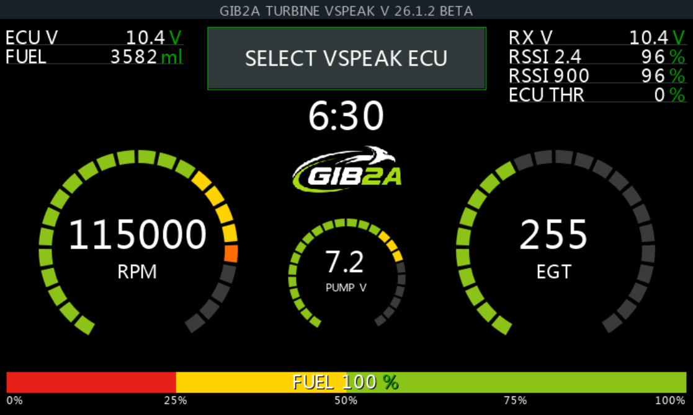

# GIB2A VS

### Advanced VSpeak Turbine Telemetry Dashboard for FrSky ETHOS

[Download GIB2A VS V26.1.2-BETA — ETHOS Suite ZIP](https://github.com/GIB2A/GIB2A-FrSky-ETHOS-VSpeak-Telemetry/releases/download/v26.1.2-BETA/GIB2A-VS-v26.1.2-BETA-ETHOS-Suite.zip)

Part of the **GIB2A Advanced Telemetry Dashboards** family.

## Overview

GIB2A VS is a telemetry-only Lua widget for FrSky ETHOS radios receiving turbine data through a VSpeak S.Port ECU converter. It presents pilot-readable RPM, EGT, remaining fuel, pump information and decoded ECU status without sending turbine, receiver, servo or pump commands.

## Features

- Flight-oriented RPM, EGT, fuel, pump and ECU-status dashboard
- Exact signed and sparse status decoding for 12 VSpeak ECU families
- Manual telemetry-source assignment with protected source recovery
- Pump PW display for KingTech and Xicoy/Kolibri; Pump Voltage display for other selected ECU types
- Configurable RPM, EGT, pump and fuel scales
- Configurable remaining-fuel alert with selectable audio file
- Optional throttle, airspeed, chrono, RX voltage and dual-band RSSI fields
- Standard, high-contrast and amber GIB2A themes
- Responsive layouts for 800×480, 640×360, 480×320 and 480×272 widget areas
- Telemetry-only operation with no control function

## VSpeak Telemetry

The widget uses manually assigned ETHOS sources for `RPM`, `Tmp1` (EGT), `Tmp2` (ECU status), `Fuel` (remaining ml), `A3` (ECU battery), `A4` (pump), `Thro`, `ASpd` and a chrono source. RX voltage and RSSI sources can also be selected manually.

The real ETHOS `source:value()` scale for A4 in KingTech and Xicoy/Kolibri configurations must be confirmed on the target radio and VSpeak hardware. No OpenTX `×100` conversion is applied.

## Supported ECU Telemetry

Status tables are included for Jakadofsky, evoJet, PBS, HORNET, JetCat, KingTech, AMT, Xicoy/Kolibri, JetCentral, Kolibri-NG, Swiwin and Linton.

This list describes decoder coverage in the widget. It does not claim certification, universal sensor availability or completed hardware validation for every ECU/VSpeak combination.

## Compatibility

- FrSky ETHOS Lua widget architecture
- Intended baseline: ETHOS 1.6.x
- ETHOS 26.1.0-RC3 and 26.1.x compatibility is targeted where the public APIs used by the widget are available
- Local layout checks cover 800×480, 640×360, 480×320 and 480×272 widget areas

No claim is made that every radio, firmware, receiver, VSpeak converter or ECU combination has been hardware-validated. See [Compatibility](docs/COMPATIBILITY.md).

## Installation

Choose either ETHOS Suite installation or the manual SD package. Verify the downloaded archive against `SHA256SUMS.txt`, restart the radio after installation, discover telemetry and confirm every assigned source before flight. See [Installation](docs/INSTALLATION.md).

## ETHOS Suite Installation

1. Download `GIB2A-VS-v26.1.2-BETA-ETHOS-Suite.zip` from the GitHub Release.
2. Verify its SHA-256 against `SHA256SUMS.txt` from the same Release.
3. Open ETHOS Suite and select `Lua Library` > `Install from local .zip`.
4. Select the ZIP without extracting it.
5. Let ETHOS Suite install the `GIB2AVS` folder.
6. Restart the radio, add `GIB2A TURBINE VSPEAK V 26.1.2 BETA` to a view, discover telemetry and assign every source manually.

The package manifest and payload files are stored directly at the ZIP root.

## Manual SD Installation

Download `GIB2A-VS-v26.1.2-BETA-SD.zip` and extract it at the SD-card root. Confirm these exact paths:

- `SCRIPTS/GIB2AVS/main.lua`
- `SCRIPTS/GIB2AVS/gib2a_logo_ethos_180.png`

Restart the radio and add the widget to a view.

## Configuration

Select the VSpeak ECU family, then assign the matching discovered telemetry sources. Configure RPM Max, EGT Max, Pump PW Max or Pump Voltage Max, fuel-tank capacity, fuel-alert threshold and sound, and the preferred theme. Pump PW is selected only for KingTech and Xicoy/Kolibri; other ECU selections use Pump Voltage.

All configured values and sources must be checked against the ECU and VSpeak telemetry before flight. See [Configuration](docs/CONFIGURATION.md).

## Display Themes

- **Standard** — original black and green GIB2A presentation
- **High contrast** — increased contrast using the protected GIB2A palette
- **Amber** — amber-oriented alternative using the same dashboard geometry

Theme selection changes colors only. Telemetry mappings, alarms and persistent source assignments remain unchanged.

## Safety and Disclaimer

GIB2A VS is telemetry-only. It does not start, stop, restart, prime or control a turbine, fuel pump, receiver, servo or throttle. Telemetry indications and alerts do not replace manufacturer instructions, pilot monitoring or pre-flight checks.

GIB2A VS is an independent project and is not affiliated with or certified by FrSky, VSpeak or the listed ECU manufacturers. Use at your own risk.

## Download

- [ETHOS Suite ZIP](https://github.com/GIB2A/GIB2A-FrSky-ETHOS-VSpeak-Telemetry/releases/download/v26.1.2-BETA/GIB2A-VS-v26.1.2-BETA-ETHOS-Suite.zip)
- [Manual SD ZIP](https://github.com/GIB2A/GIB2A-FrSky-ETHOS-VSpeak-Telemetry/releases/download/v26.1.2-BETA/GIB2A-VS-v26.1.2-BETA-SD.zip)
- [SHA-256 checksums](https://github.com/GIB2A/GIB2A-FrSky-ETHOS-VSpeak-Telemetry/releases/download/v26.1.2-BETA/SHA256SUMS.txt)

## Release Information

- Version: `26.1.2-BETA`
- Tag: `v26.1.2-BETA`
- Release type: **Pre-release**
- Installed folder: `GIB2AVS`
- Internal widget key: `GIB2AVS`
- Runtime files: `main.lua`, `gib2a_logo_ethos_180.png`

## GIB2A Product Family

- [GIB2A TURBINE](https://github.com/GIB2A/GIB2A-FrSky-ETHOS-Turbine-Telemetry) — advanced turbine telemetry dashboard for ETHOS
- [GIB2A POWER](https://github.com/GIB2A/GIB2A-FrSky-ETHOS-Power-Telemetry) — advanced electric-power and FrSky Neuron ESC telemetry dashboard for ETHOS
- **GIB2A VS** — VSpeak turbine telemetry dashboard for ETHOS

## License

Released under the [MIT License](LICENSE).
